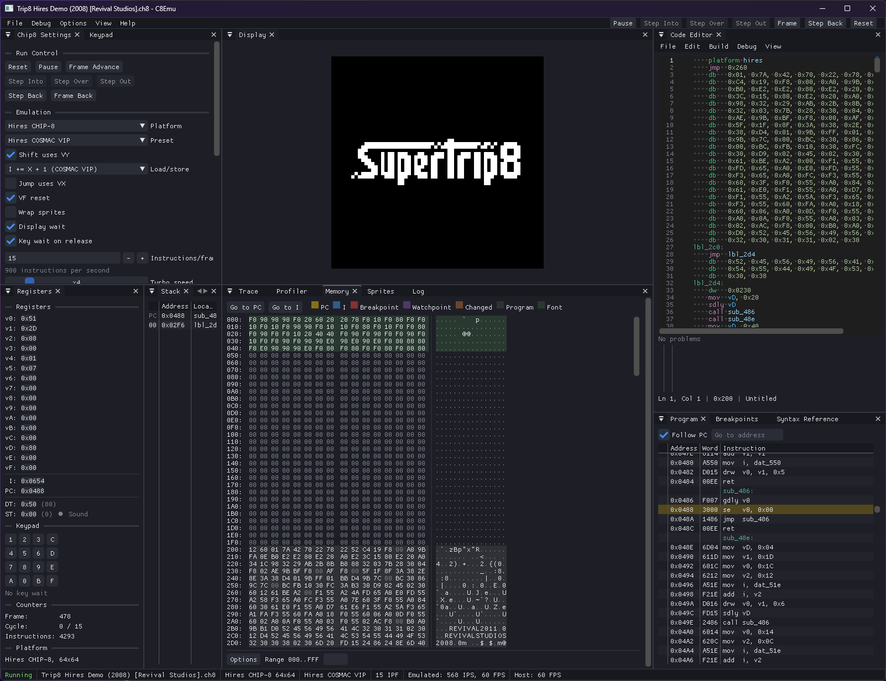

# C8Emu

A CHIP-8 emulator

## Requirements

- A C++23 compiler
- CMake 3.21 or newer for the presets (3.14 or newer without them)
- [vcpkg][vcpkg], with the `VCPKG_ROOT` environment variable set
- OpenGL 4.5

vcpkg installs all the libraries. [vcpkg.json](vcpkg.json) lists them:
- [SDL3](https://github.com/libsdl-org/SDL)
- [GLAD](https://github.com/Dav1dde/glad)
- [Glaze](https://github.com/stephenberry/glaze) for the settings file
- [Dear ImGui](https://github.com/ocornut/imgui) (docking branch)
- [ImGuiColorTextEdit](https://github.com/goossens/ImGuiColorTextEdit) (Johan A. Goossens fork)
- [imgui_club](https://github.com/ocornut/imgui_club) memory editor

The vcpkg registry does not have the last two libraries.
The [ports](ports) directory holds overlay ports for them.

## Building

See [BUILDING.md](BUILDING.md) for a user build.
See [HACKING.md](HACKING.md) for a developer build.

## Documentation

- [docs/assembler.md](docs/assembler.md): the assembly language
- [docs/debugging.md](docs/debugging.md): the debugger, the history, and the save states

## Settings and saved files

C8Emu keeps its files in the user data folder. On Windows, this folder is
`%APPDATA%\cbrl\C8Emu`. The Log shows the folder when C8Emu starts.

## Example

[vcpkg]: https://github.com/microsoft/vcpkg
